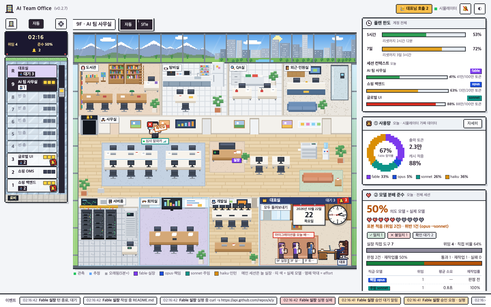
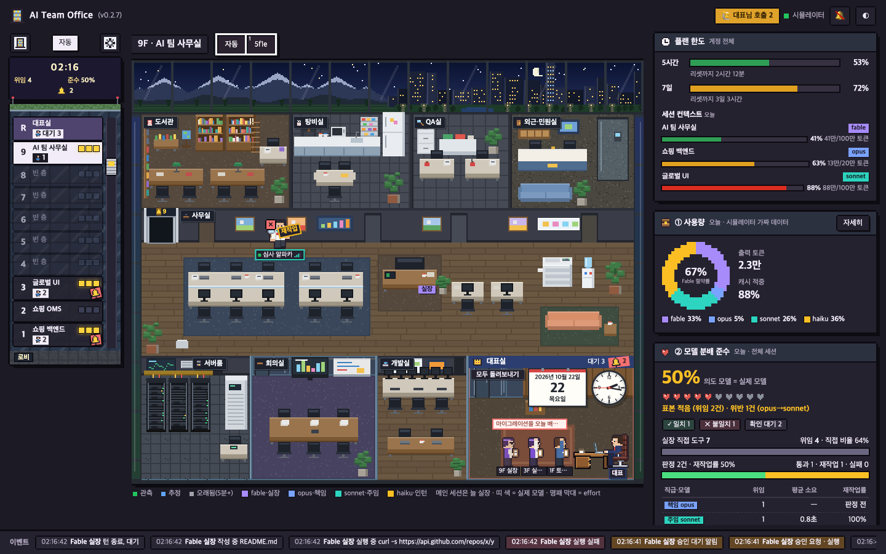
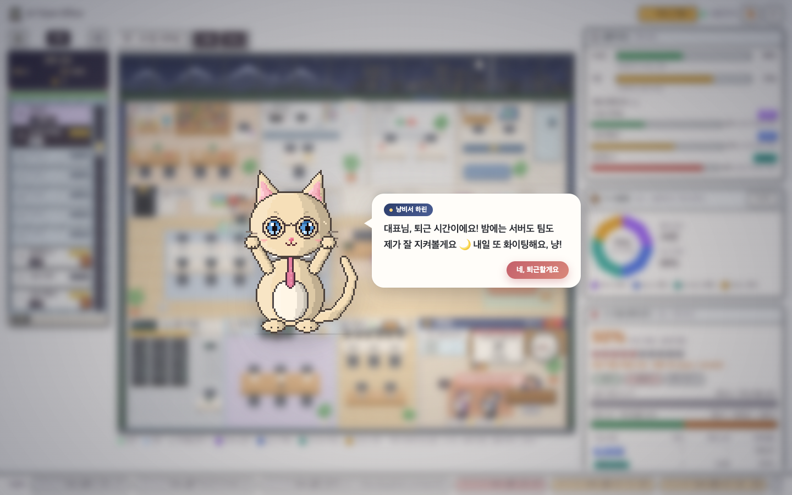

# ai-team-office

**English** | [한국어](#한국어)

A Claude Code plugin that turns your session into a model-routed AI team: a Fable/Opus main session that plans and verifies, cheaper subagents that do the work, a delegation log with verification verdicts, and a real-time pixel office dashboard.






## Features

- **Building with one floor per project.** Each project you work in gets its own floor; a floor editor lets you rename floors, reorder them and pick the layout. Floors are stored in a local `building.json` (see `building.example.json`).
- **Voxel-style pixel office** seen through a glass curtain wall: rooms for reading, writing, review, servers, meetings and the CEO room, with day/night sky and light/dark themes.
- **Ranks, roles and animal nicknames.** Every session and subagent gets a role, a rank and a stable animal nickname so you can tell them apart at a glance.
- **CEO room with answerable approvals and questions.** Permission prompts and `AskUserQuestion` questions show up in the dashboard and can be answered there (approve, deny, or pick an option). A **"돌려보내기"** (hand back) button returns the decision to the terminal prompt.
- **Terminal focus.** A button jumps to the terminal window of a session (`/focus`, macOS only).
- **Plan limits and context.** The 5-hour and 7-day plan limits plus context usage per session, taken from the statusline JSON.
- **Token usage charts** per model and per day.
- **19:00 cat secretary** who reminds you to wrap up for the day.

### Optional extras (opt-in)

Both are offered by `/ai-team:ai-team-setup`, shown first and applied only on an explicit yes, with a backup of `~/.claude/settings.json`:

- **CEO-room relay** (`office/hooks/ceo-relay.sh`) forwards permission requests and questions to the dashboard. It is **not** in the default hooks. It steps aside instantly when no dashboard tab is open, only ever answers from the dashboard, and `OFFICE_RELAY_DISABLE=1` turns it off.
- **Plan limit display**: a statusline wrapper (`bin/statusline-tee`) saves the statusline JSON for the dashboard and then runs your previous statusline command unchanged.

### Honest limits

- No free-form text injection: the dashboard can approve, deny or choose among offered options, but cannot type text into your terminal session.
- No per-model weekly limit: only what the statusline JSON exposes (5-hour and 7-day totals).
- Terminal focus is macOS only; on other systems the button is hidden or reports failure.
- Everything is observed from hooks; inferred states are labelled as such.

## Quick start

**Requirements:** `node` >= 20 (dashboard), `jq` (hooks) and `curl` (relay). macOS or Linux; `/focus` (terminal focus) needs macOS.

```bash
claude plugin marketplace add bluelang1/ai-team-office
claude plugin install ai-team@ai-team-office
```

Then, inside Claude Code:

1. `/ai-team:ai-team-setup` - shows the operating rules and, only if you say yes, appends them to `~/.claude/CLAUDE.md`.
2. `/ai-team:office` - starts the dashboard and opens http://127.0.0.1:4747.
3. Optional: run `/ai-team:ai-team-setup` again and say yes to the CEO-room relay to answer approvals from the dashboard. **Keep the dashboard tab open**: the relay only waits while a tab is open (a background tab is fine for permission prompts; questions need the tab visible).

## Update

```bash
claude plugin marketplace update ai-team-office && claude plugin update ai-team@ai-team-office
```

Then **start a new Claude Code session** (a session opened before the update still points at the old plugin folder) and run `/ai-team:office restart`, or run `~/.claude/plugins/marketplaces/ai-team-office/plugins/ai-team/office/start.sh restart` from any shell. It stops the running dashboard (even one started by the previous version) and starts the new one. Open tabs reload themselves, and the header shows `(vX.Y.Z)` so you can see which version is running. Sessions started before the update keep their old hooks until you restart them.

If you installed the relay or statusline wrapper with an older setup, run `/ai-team:ai-team-setup` once more: it offers to move them to a version-independent path so they follow future updates.

## Troubleshooting

- **No approve/deny buttons in the CEO room (대표실).** The relay is opt-in: install it with `/ai-team:ai-team-setup`. A dashboard tab at http://127.0.0.1:4747 must be open (background is fine for permission prompts; questions need it visible). Check `curl -s http://127.0.0.1:4747/healthz` (`viewers`, `hiddenViewers`, `pending`), and `~/.claude/ai-team-office/run/server.log` for `not relayed: <reason>`.
- **Header shows an old version.** The old server is still running: `/ai-team:office restart`.
- **Dashboard does not start.** Check `node --version` (needs >= 20) and `/ai-team:office status`; the log is `~/.claude/ai-team-office/run/server.log`.
- **Report text is cut short.** That session started before an update and still runs the old hook: restart the session.
- **Turn the relay off.** Remove it with the Undo step of `/ai-team:ai-team-setup`, or `export OFFICE_RELAY_DISABLE=1` in your shell before starting `claude` (applies to sessions started afterwards). The terminal prompts then work as before.

## Routing table

| Kind of work | Agent | Model / effort |
|---|---|---|
| Lookups, search, status | `lookup` | haiku / low |
| Read-only ops investigation, clear-spec test additions | `ops-investigator` / `implementer` | sonnet / medium |
| Implementation, migrations (default) | `implementer` | opus / high |
| Review, design, incident root cause, security | `reviewer` | opus / high |
| Planning, verification, ambiguous decisions | main session | main model |

Full rules: [`plugins/ai-team/rules/OPERATING_RULES.md`](plugins/ai-team/rules/OPERATING_RULES.md).

## How office states are derived

The dashboard only reads hook logs, so every state is either **observed** (a hook event says so) or **inferred** (a timer or a guess). Inferred states are labelled as such in the UI, and "stale" is never read as "gone".

| Shown | Derived from | Kind |
|---|---|---|
| Library (reading) | `PreToolUse` of Read, Grep, Glob, LSP, WebFetch, WebSearch, ToolSearch; Bash `rg`/`cat`/`ls`/`git log` etc. | observed |
| Workbench (writing) | `PreToolUse` of Edit, Write, NotebookEdit; Bash `sed -i`, `>` redirects, `mkdir` | observed |
| External desk | `mcp__*` tools; Bash `curl`, `gh`, `aws`, `git push`, `npm publish` | observed |
| Server room | any other Bash command | observed |
| Meeting room | `PreToolUse` of Agent (delegation) | observed |
| Review room | tool activity of a `code-reviewer` subagent | observed |
| Thinking bubble | right after `UserPromptSubmit`, or no next tool 3 s after `PostToolUse` | inferred |
| Hand up, "awaiting approval" | `PermissionRequest` or permission-prompt `Notification`; cleared by that character's next event | observed |
| Stuck (amber) | no `PostToolUse` 60 s after `PreToolUse` (shown as "waiting on delegation" while main waits for a sync Agent call) | inferred |
| Sleeping (zzz) | no event from that character for 3 min | inferred |
| Faded (stale) | no event for 5 min; not treated as gone | inferred |
| Lightning | `PostToolUseFailure` | observed |
| Elevator arrive / leave + stamp | `SubagentStart` / `SubagentStop`; stamp from `delegation.jsonl` verdict (ok/rework/fail) | observed |
| Intended vs actual model | `model` in the Agent call vs the resolved model afterwards | observed |
| Subagent with no `SubagentStop` | leaves after 5 min idle (10 min if a tool is running); delegations without a match expire after 10 min | inferred |

**Not shown from hooks:** context-window usage and plan limits come only from the optional statusline wrapper, and the main session's model is assumed to be Fable for every event. Decorations (breathing, blinking, coffee cup) mean nothing. Details: [`plugins/ai-team/office/README.md`](plugins/ai-team/office/README.md) and [`DESIGN.md`](plugins/ai-team/office/DESIGN.md).

## Privacy and security

- Local only: the dashboard binds to `127.0.0.1`; nothing is sent anywhere.
- Host and Origin checks on every request (DNS-rebinding and cross-site protection); POST requires `Content-Type: application/json`.
- Viewer rule: the relay only holds a request while a real dashboard tab is open (any tab for permission prompts, since the terminal prompt stays usable alongside; a visible tab for questions, which block the terminal until the hook returns); otherwise it steps aside and the terminal prompt works as usual.
- Consumes no tokens: it only reads local logs under `~/.claude/logs/`.
- Use `--redact` to mask prompts, file paths and command arguments in what the dashboard displays.

## Credits

Inspired by @cowboy76's office post, and by [Pixel Agents](https://github.com/pixel-agents-hq/pixel-agents), [Claude-Office](https://github.com/W17ant/Claude-Office) and [agent-virtual-office](https://github.com/KbWen/agent-virtual-office).

## License

MIT, see [LICENSE](LICENSE).

---

## 한국어

모델 라우팅 AI 팀을 Claude Code 에 입히는 플러그인입니다. 계획·검수는 Fable/Opus 메인이, 실제 작업은 더 저렴한 서브에이전트가 맡고, 위임 로그(검수 판정 포함)와 실시간 픽셀 오피스 대시보드를 제공합니다.

### 주요 기능

- **프로젝트별 층이 있는 빌딩**: 프로젝트마다 한 층, 층 편집기로 이름·순서·배치 변경(로컬 `building.json`).
- **복셀 느낌의 픽셀 오피스**: 유리 커튼월 너머로 보이는 도서관·작업대·검수실·서버실·회의실·대표실, 낮/밤 하늘, 라이트/다크.
- **직급·역할·동물 닉네임**: 세션과 서브에이전트마다 역할·직급·고정 동물 닉네임.
- **답할 수 있는 대표실**: 승인 요청과 `AskUserQuestion` 질문을 대시보드에서 승인/거부/보기 선택으로 답하고, **돌려보내기** 로 터미널 프롬프트에 되돌립니다.
- **터미널 포커스**: 세션의 터미널 창을 앞으로(`/focus`, macOS 전용).
- **플랜 한도·컨텍스트**: 5시간/7일 한도와 세션별 컨텍스트(상태줄 JSON 기반).
- **토큰 사용량 차트**, **19:00 고양이 비서**.

선택(opt-in) 기능: `/ai-team:ai-team-setup` 이 "대표실 relay"(`office/hooks/ceo-relay.sh`)와 "플랜 한도 표시"(상태줄 래퍼)를 보여주고, 명시적으로 yes 할 때만 백업 후 `~/.claude/settings.json` 에 병합합니다. relay 는 대시보드 탭이 없으면 즉시 비켜서고, 대시보드에서만 답하며, `OFFICE_RELAY_DISABLE=1` 로 끌 수 있습니다.

**한계(솔직하게)**: 자유 텍스트 입력은 터미널로 보낼 수 없고(승인/거부/보기 선택만), 모델별 주간 한도는 없으며(상태줄이 주는 5시간/7일 합계만), 터미널 포커스는 macOS 전용입니다.

### 30초 설치

요구 사항: `node` 20 이상, `jq`(훅), `curl`(relay), `/focus` 는 macOS.

```bash
claude plugin marketplace add bluelang1/ai-team-office
claude plugin install ai-team@ai-team-office
```

Claude Code 안에서:

1. `/ai-team:ai-team-setup` - 운영 규칙을 보여주고, 동의(yes)할 때만 `~/.claude/CLAUDE.md` 에 추가합니다.
2. `/ai-team:office` - 대시보드를 켜고 http://127.0.0.1:4747 을 엽니다.
3. 선택: `/ai-team:ai-team-setup` 을 한 번 더 실행해 대표실 relay 에 yes 하면 대시보드에서 승인할 수 있어요. **대시보드 탭은 열어 두세요**: 탭이 열려 있을 때만 relay 가 기다립니다(권한 요청은 백그라운드 탭이어도 되고, 질문은 탭이 보여야 해요).

### 업데이트

```bash
claude plugin marketplace update ai-team-office && claude plugin update ai-team@ai-team-office
```

그다음 **새 Claude Code 세션을 열어**(업데이트 전에 연 세션은 예전 플러그인 폴더를 가리켜요) `/ai-team:office restart` 를 실행하거나, 아무 셸에서 `~/.claude/plugins/marketplaces/ai-team-office/plugins/ai-team/office/start.sh restart` 를 실행하세요. 실행 중인 대시보드를(이전 버전이 띄운 것이어도) 끄고 새 버전으로 켭니다. 열린 탭은 스스로 새로고침되고, 헤더의 `(vX.Y.Z)` 로 지금 돌고 있는 버전을 확인할 수 있어요. 업데이트 전에 시작한 세션은 재시작할 때까지 예전 훅을 씁니다.

예전 setup 으로 relay·상태줄 래퍼를 설치했다면 `/ai-team:ai-team-setup` 을 한 번 더 실행하세요. 버전과 무관한 경로로 옮길지 물어보고, 그 뒤로는 업데이트를 자동으로 따라갑니다.

### 문제 해결

- **대표실에 승인/거부 버튼이 안 보여요.** relay 는 선택 설치예요: `/ai-team:ai-team-setup` 으로 설치하세요. http://127.0.0.1:4747 대시보드 탭이 열려 있어야 해요(권한 요청은 백그라운드여도 되고, 질문은 보여야 해요). `curl -s http://127.0.0.1:4747/healthz` 로 `viewers`·`hiddenViewers`·`pending` 을 보고, `~/.claude/ai-team-office/run/server.log` 에서 `not relayed: <이유>` 를 찾아보세요.
- **헤더 버전이 예전 그대로예요.** 예전 서버가 아직 돌고 있어요: `/ai-team:office restart`.
- **대시보드가 안 켜져요.** `node --version`(20 이상 필요)과 `/ai-team:office status` 를 확인하세요. 로그는 `~/.claude/ai-team-office/run/server.log`.
- **보고 내용이 중간에 잘려요.** 업데이트 전에 시작한 세션이라 예전 훅이 돌고 있어요: 세션을 재시작하세요.
- **relay 끄기.** `/ai-team:ai-team-setup` 의 Undo 로 지우거나, `claude` 를 시작하기 전에 셸에서 `export OFFICE_RELAY_DISABLE=1` 하세요(그 뒤에 시작한 세션부터 적용). 터미널 프롬프트는 원래대로 동작해요.

### 분배표

| 일의 성격 | 에이전트 | 모델 / effort |
|---|---|---|
| 조회·탐색·상태 확인 | `lookup` | haiku / low |
| 읽기 전용 운영 조사, 스펙 명확한 테스트 보강 | `ops-investigator` / `implementer` | sonnet / medium |
| 구현·마이그레이션 (기본) | `implementer` | opus / high |
| 리뷰·설계·장애 원인·보안 | `reviewer` | opus / high |
| 계획·검증·모호한 결정 | 메인 세션 | 메인 모델 |

### 상태는 어떻게 판정하나

모든 상태는 **관측**(훅 이벤트가 직접 말함) 또는 **추정**(타이머·유추)입니다. 영문 표를 참고하세요: 도구→방 매핑(Bash 는 명령 머리로 자료실/작업대/외부창구/서버실 분류), 막힘 60초, 💤 3분, 흐림 5분, 위임 만료 10분. 컨텍스트·플랜 한도는 선택 설치하는 상태줄 래퍼에서만 오고, 메인 모델은 Fable 로 가정합니다. 자세한 내용은 [`office/README.md`](plugins/ai-team/office/README.md).

### 프라이버시·보안

- 로컬 전용: `127.0.0.1` 에만 바인딩하며 외부로 아무것도 보내지 않습니다.
- 모든 요청에 Host/Origin 검사(DNS rebinding·교차 사이트 차단), POST 는 `application/json` 필수.
- 뷰어 규칙: 대시보드 탭이 실제로 열려 있을 때만 relay 가 요청을 붙잡습니다(권한 요청은 백그라운드 탭도 됨 — 터미널 프롬프트가 함께 떠 있으므로; 질문은 훅이 끝날 때까지 터미널을 막으므로 보이는 탭만). 아니면 즉시 비켜 터미널 프롬프트가 그대로 동작합니다.
- 토큰 소모 없음: `~/.claude/logs/` 의 로컬 로그만 읽습니다.
- `--redact` 로 프롬프트·경로·명령 인자를 가릴 수 있습니다.

### 크레딧

@cowboy76 님의 오피스 게시글에서 영감을 받았고, [Pixel Agents](https://github.com/pixel-agents-hq/pixel-agents), [Claude-Office](https://github.com/W17ant/Claude-Office), [agent-virtual-office](https://github.com/KbWen/agent-virtual-office) 를 참고했습니다.

### 라이선스

MIT. [LICENSE](LICENSE) 참고.
